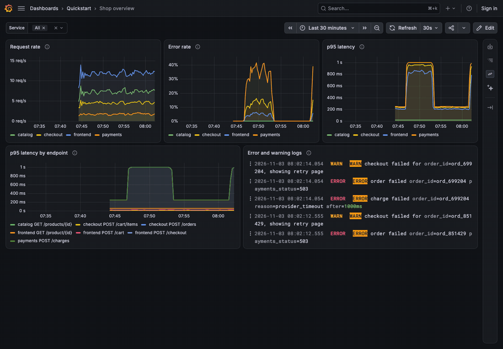
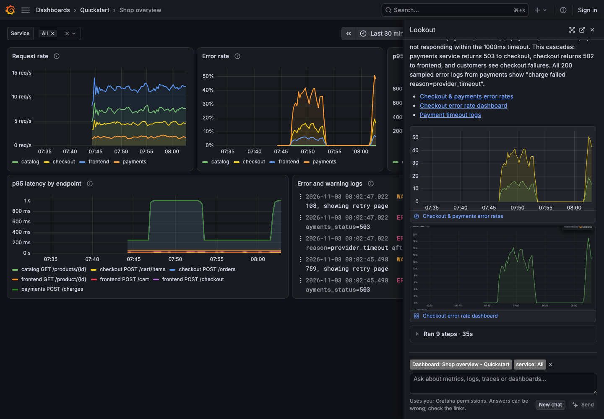
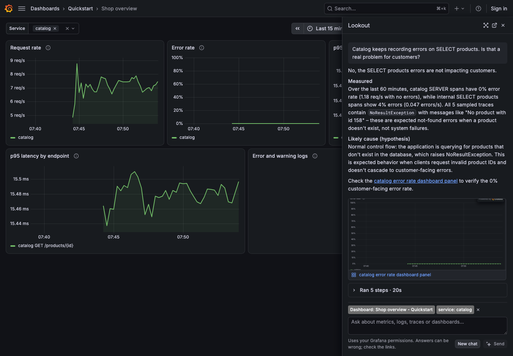
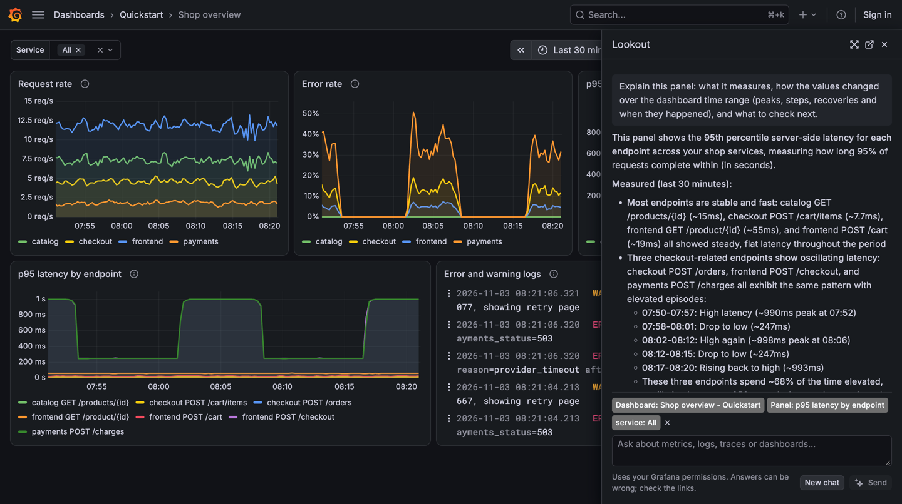
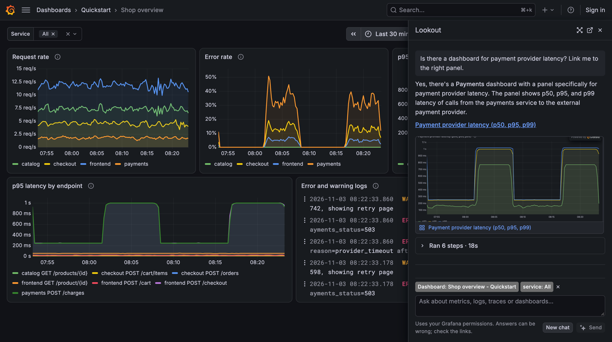
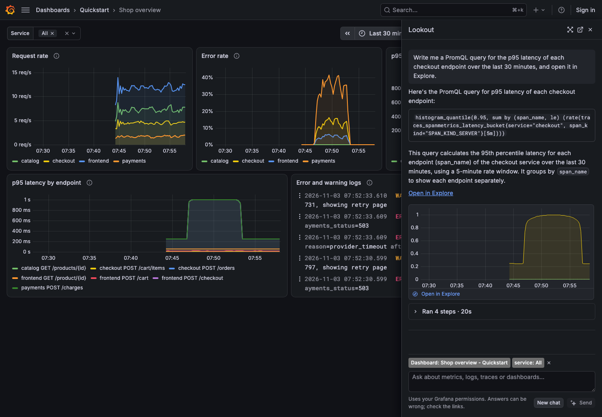
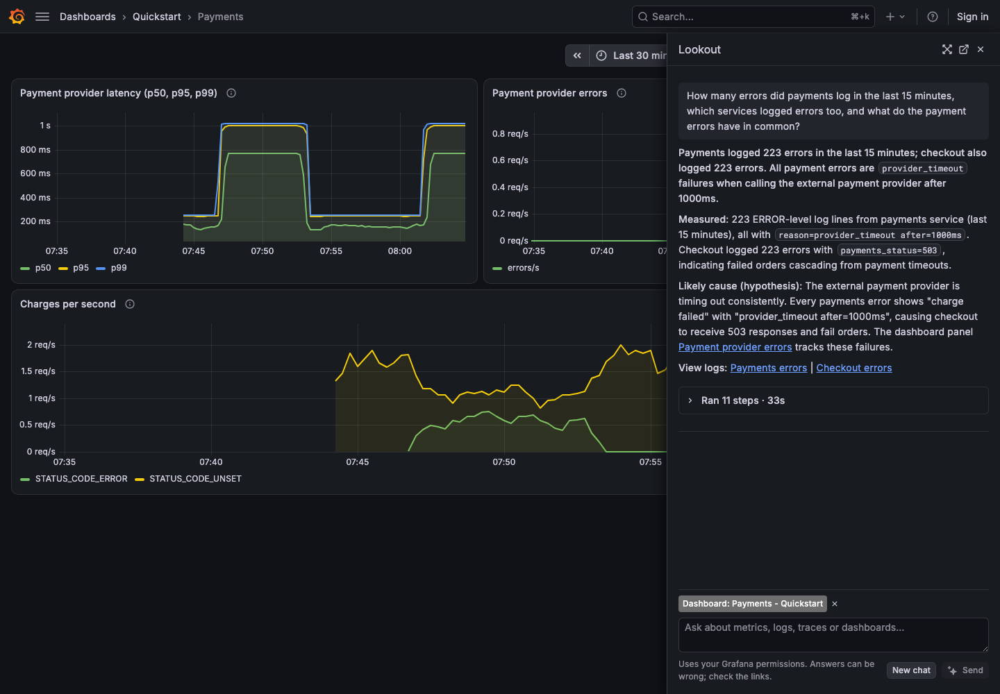
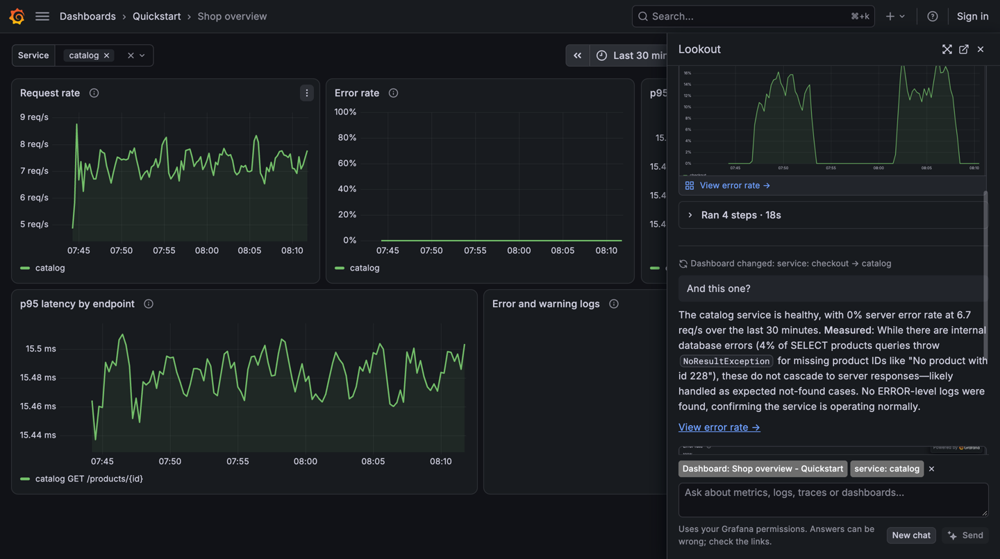
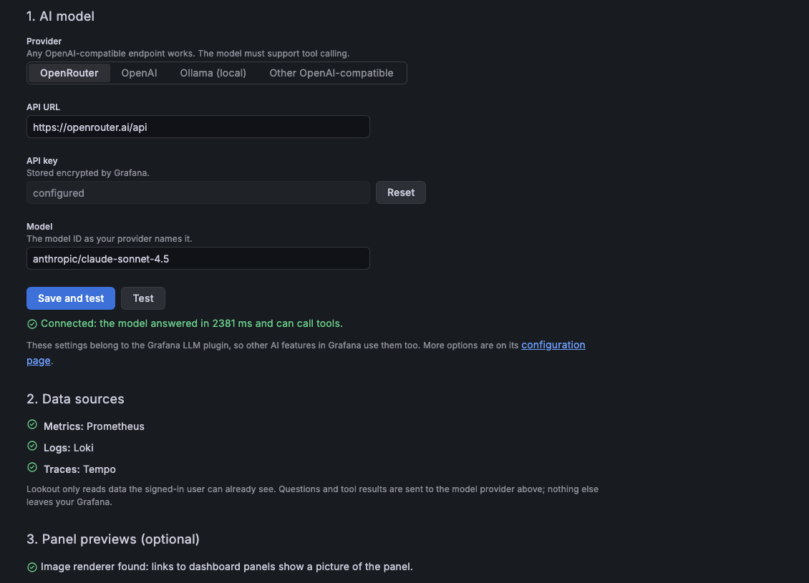

# Lookout

[](https://github.com/agarwalvivek29/grafana-lookout/actions/workflows/ci.yml)
[](https://github.com/agarwalvivek29/grafana-lookout/actions/workflows/security.yml)
[](https://scorecard.dev/viewer/?uri=github.com/agarwalvivek29/grafana-lookout)
[](LICENSE)

An open-source AI assistant for Grafana. Ask about your metrics, logs, traces and dashboards in plain
language, and get a short answer with links you can check: the dashboard panel that shows it, or an
Explore query.

Lookout is a regular app plugin for self-hosted Grafana. It needs no Grafana Cloud account and no
service in between: the model is whatever OpenAI-compatible endpoint you choose (OpenRouter, OpenAI,
a local Ollama, or your own gateway), reached through the open-source
[Grafana LLM plugin](https://grafana.com/grafana/plugins/grafana-llm-app/).



_An on-call question on the [quickstart](examples/quickstart) demo shop. Lookout reads the dashboard, runs a
health check, opens failing traces and logs, and answers with what it measured, the likely cause, and links
you can check. Every query runs as you, read-only._

## See it in action

All examples below are real, unedited answers from the [quickstart](examples/quickstart) stack: a demo shop
(`frontend`, `catalog`, `checkout`, `payments`) whose payment provider has a 6-minute outage every 15 minutes. You can run
the same questions yourself in two minutes.

### Find the cause of an incident

> Checkout is failing for customers. What's going on?

Lookout checks error rates per endpoint, compares with earlier, opens real failing traces to read the exception
(`PaymentProviderTimeout`), and follows the failure from the payment provider through `payments` and
`checkout` to the customer. It ends with a picture of the matching dashboard panel and a live Explore chart.



### Tell noise from real failures

> Catalog keeps recording errors on SELECT products. Is that a real problem for customers?

Not every error is an outage. Lookout reads the sampled exceptions (`NoResultException: No product with id
158`), sees that customer-facing requests have a 0% error rate, and says these are expected "not found"
lookups. It doesn't sound the alarm.



### Explain a panel

Panel menu → **Extensions → Explain with AI**. Lookout reads the panel's query, looks at the whole time range,
and says what changed and when: three slow episodes on the checkout path, and which endpoints stayed flat.



### Find the right dashboard

> Is there a dashboard for payment provider latency? Link me to the right panel.

Lookout searches your dashboards, reads their panels, and links the exact panel, with a picture of it under
the answer.



### Write a query for you

> Write me a PromQL query for the p95 latency of each checkout endpoint over the last 30 minutes, and open it in Explore.

It finds the right metric and labels, writes the query, checks that it returns data, and previews the result.



### Read the logs

> How many errors did payments log in the last 15 minutes, which services logged errors too, and what do the payment errors have in common?

Lookout counts and groups log lines in Loki (Quickwit works too), and connects the 223 payment timeouts to
the 223 failed orders in `checkout`.



### Follow the dashboard you're on

Change a dashboard variable and keep talking. Lookout notices ("Dashboard changed: service: checkout →
catalog") and answers "And this one?" for what's on screen now.



### Set up in one page

Pick a provider, paste a key, click **Save and test**. The setup page checks that the model can call tools and
lists the data sources Lookout can use.



## What it does

- **Ask from where you are.** "Ask Lookout AI" on every dashboard opens a side panel that knows the dashboard,
  its variables and time range, and keeps up when you change them. Panel menus get "Ask Lookout AI" and
  "Explain with AI"; the command palette gets "Ask Lookout AI…"; there is also a full-page chat.
- **Answers you can check.** Each answer ends with links: an existing dashboard panel when one shows
  the answer, otherwise an Explore query. Links are previewed under the answer, as a picture of the
  panel (with the Grafana Image Renderer) or a live chart.
- **Finds things.** "Where is the latency dashboard for checkout?", "Which services have the most
  errors right now?", "Show me the slowest traces in the last hour".
- **Careful by default.** Compares with yesterday before calling something high, reads real error
  traces before calling them failures, and says what is measured and what is a guess.

## Requirements

- Grafana OSS or Enterprise **13.2 or newer** (self-hosted).
- The [Grafana LLM plugin](https://grafana.com/grafana/plugins/grafana-llm-app/) (installed with Lookout).
- A model that supports tool calling, behind an OpenAI-compatible API.
- At least one supported data source:

| Signal  | Data sources                                                                    |
| ------- | ------------------------------------------------------------------------------- |
| Metrics | Prometheus data source type: Prometheus, Grafana Mimir, VictoriaMetrics, Thanos |
| Logs    | Loki, Quickwit                                                                  |
| Traces  | Tempo                                                                           |

Dashboards of any data source can be found, explained and linked.

## Install

**From a GitHub release** (until Lookout is in the plugin catalog). The release zip is not signed yet,
so allow it explicitly:

```ini
# grafana.ini
[plugins]
preinstall_sync = grafana-llm-app,agarwalvivek29-lookout-app@0.1.0@https://github.com/agarwalvivek29/grafana-lookout/releases/download/v0.1.0/agarwalvivek29-lookout-app-0.1.0.zip
allow_loading_unsigned_plugins = agarwalvivek29-lookout-app
```

The same with environment variables (Docker, Kubernetes):

```sh
GF_PLUGINS_PREINSTALL_SYNC=grafana-llm-app,agarwalvivek29-lookout-app@0.1.0@https://github.com/agarwalvivek29/grafana-lookout/releases/download/v0.1.0/agarwalvivek29-lookout-app-0.1.0.zip
GF_PLUGINS_ALLOW_LOADING_UNSIGNED_PLUGINS=agarwalvivek29-lookout-app
```

With the Grafana Helm chart, put both variables under `env:` in your values.

## Set up

1. Open **Administration → Plugins → Lookout** (or **Apps → Lookout → Setup**) and click **Enable**.
2. Under **AI model**, choose a provider, paste the API key, enter a model ID and click **Save and test**.
   The test checks that the model can call tools.
3. Check **Data sources**: it lists the metrics, logs and traces sources Lookout found.
4. Open any dashboard and click **Ask Lookout AI** in the dashboard sidebar.

Prefer configuration as code? Provision the LLM plugin instead of using step 2:

```yaml
# provisioning/plugins/llm.yaml
apiVersion: 1
apps:
  - type: grafana-llm-app
    jsonData:
      provider: custom # any OpenAI-compatible endpoint; use "openai" for OpenAI
      openAI:
        url: https://openrouter.ai/api
      models:
        default: base
        mapping:
          base: anthropic/claude-sonnet-4.5
          large: anthropic/claude-sonnet-4.5
    secureJsonData:
      openAIKey: $LLM_API_KEY
  - type: agarwalvivek29-lookout-app
    disabled: false
```

Panel pictures in previews need the
[Grafana Image Renderer](https://grafana.com/docs/grafana/latest/setup-grafana/image-rendering/). Without it,
Explore links still get live charts.

## Security and privacy

- Every tool runs in the browser as the signed-in user, through Grafana's own APIs. Lookout sees only
  what that user can already see, and it only reads; it does not change dashboards or data sources.
- What leaves your network: the question, the dashboard context, and the tool results needed to answer,
  sent to the model provider you configured. Use a local model (for example Ollama) to keep everything
  inside.
- Tool results (log lines, trace attributes, dashboard text) are treated as data, never as instructions.
  Answers are rendered as sanitized Markdown; only links back into your Grafana are clickable.
- Set a spend limit on your provider API key; that is the hard limit on cost.

## Links

- Source and issues: https://github.com/agarwalvivek29/grafana-lookout
- [Roadmap](ROADMAP.md): what is coming next
- [Security policy](SECURITY.md): how to report a vulnerability
- License: [Apache 2.0](LICENSE)

## Try it locally

[`examples/quickstart`](examples/quickstart) starts Grafana with Prometheus, Loki, Tempo, the image renderer
and the demo shop used in the examples above, so you can try Lookout without your own data. See its README.

## Develop

Requirements: Node.js 22, Go 1.26, Docker.

```sh
npm install
npm run dev               # frontend in watch mode
go run github.com/magefile/mage@v1.15.0 -v build:linuxARM64   # backend (or `mage -v` for all platforms)
cp .env.example .env      # model endpoint and key for the dev Grafana (git-ignored)
docker compose up --build # Grafana on http://localhost:3000 with the plugin, TestData and an image renderer
```

Checks: `npm run typecheck`, `npm run lint`, `npm run test:ci`, `npm run e2e`.

Code map:

- `src/agent/agent.ts`: the agent loop and its read-only tools (metrics, logs, traces, dashboards).
- `src/chat/`: chat UI, side panel, safe Markdown, link previews, conversation store.
- `src/components/AppConfig/`: the setup page.
- `src/module.tsx`: entry points (dashboard sidebar, panel menu, command palette).

## Contributing

Contributions are welcome. Read [CONTRIBUTING.md](CONTRIBUTING.md) for setup, the rules every change must
follow, and the DCO sign-off. Adapters for more data sources (Elasticsearch/OpenSearch logs, VictoriaLogs,
Jaeger traces) are a good place to start; see the [roadmap](ROADMAP.md). Everyone taking part follows the
[Code of Conduct](CODE_OF_CONDUCT.md).
