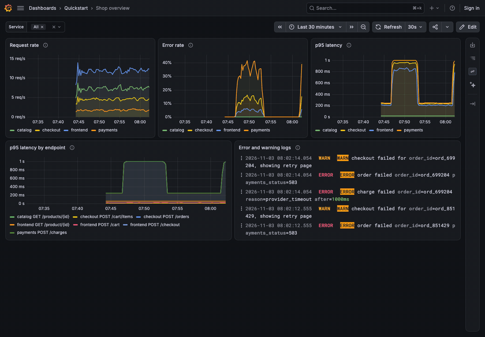
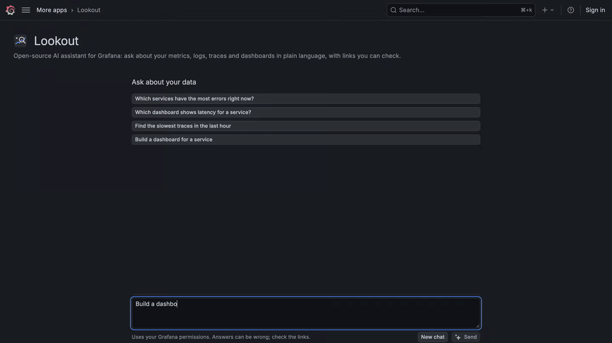

# Lookout

An open-source AI assistant for Grafana. Ask about your metrics, logs, traces and dashboards in plain
language, and get a short answer with links you can check: the dashboard panel that shows it, or an
Explore query.

Lookout is a regular app plugin for self-hosted Grafana. It needs no Grafana Cloud account and no
service in between: the model is whatever OpenAI-compatible endpoint you choose (OpenRouter, OpenAI,
a local Ollama, or your own gateway), reached through the open-source
[Grafana LLM plugin](https://grafana.com/grafana/plugins/grafana-llm-app/).





More examples (explaining panels, finding dashboards, writing queries, building dashboards, reading logs):
[see them on GitHub](https://github.com/agarwalvivek29/grafana-lookout#see-it-in-action).

## What it does

- **Ask from where you are.** "Ask Lookout AI" on every dashboard opens a side panel that knows the dashboard,
  its variables and time range, and keeps up when you change them. Panel menus get "Ask Lookout AI" and
  "Explain with AI"; the command palette gets "Ask Lookout AI…"; there is also a full-page chat.
- **Answers you can check.** Each answer ends with links: an existing dashboard panel when one shows
  the answer, otherwise an Explore query. Links are previewed under the answer, as a picture of the
  panel (with the Grafana Image Renderer) or a live chart.
- **Finds things.** "Where is the latency dashboard for checkout?", "Which services have the most
  errors right now?", "Show me the slowest traces in the last hour".
- **Builds and edits dashboards.** "Build a dashboard for checkout", "add a p99 line to this panel", "make
  the error panel a percentage". You see the change with live previews first; nothing is saved until you
  click Apply, and Undo puts it back. Provisioned dashboards get a copy instead of an in-place change.
- **Careful by default.** Compares with yesterday before calling something high, reads real error
  traces before calling them failures, and says what is measured and what is a guess.

## Requirements

- Grafana OSS or Enterprise **13.2 or newer** (self-hosted).
- The [Grafana LLM plugin](https://grafana.com/grafana/plugins/grafana-llm-app/) (installed with Lookout).
- A model that supports tool calling, behind an OpenAI-compatible API.
- At least one supported data source:

| Signal  | Data sources                                                                    |
| ------- | ------------------------------------------------------------------------------- |
| Metrics | Prometheus data source type: Prometheus, Grafana Mimir, VictoriaMetrics, Thanos |
| Logs    | Loki, Quickwit                                                                  |
| Traces  | Tempo                                                                           |

Dashboards of any data source can be found, explained and linked.

## Install

**From a GitHub release** (until Lookout is in the plugin catalog). The release zip is not signed yet,
so allow it explicitly:

```ini
# grafana.ini
[plugins]
preinstall_sync = grafana-llm-app,agarwalvivek29-lookout-app@0.1.0@https://github.com/agarwalvivek29/grafana-lookout/releases/download/v0.1.0/agarwalvivek29-lookout-app-0.1.0.zip
allow_loading_unsigned_plugins = agarwalvivek29-lookout-app
```

The same with environment variables (Docker, Kubernetes):

```sh
GF_PLUGINS_PREINSTALL_SYNC=grafana-llm-app,agarwalvivek29-lookout-app@0.1.0@https://github.com/agarwalvivek29/grafana-lookout/releases/download/v0.1.0/agarwalvivek29-lookout-app-0.1.0.zip
GF_PLUGINS_ALLOW_LOADING_UNSIGNED_PLUGINS=agarwalvivek29-lookout-app
```

With the Grafana Helm chart, put both variables under `env:` in your values.

## Set up

1. Open **Administration → Plugins → Lookout** (or **Apps → Lookout → Setup**) and click **Enable**.
2. Under **AI model**, choose a provider, paste the API key, enter a model ID and click **Save and test**.
   The test checks that the model can call tools.
3. Check **Data sources**: it lists the metrics, logs and traces sources Lookout found.
4. Open any dashboard and click **Ask Lookout AI** in the dashboard sidebar.

Prefer configuration as code? Provision the LLM plugin instead of using step 2:

```yaml
# provisioning/plugins/llm.yaml
apiVersion: 1
apps:
  - type: grafana-llm-app
    jsonData:
      provider: custom # any OpenAI-compatible endpoint; use "openai" for OpenAI
      openAI:
        url: https://openrouter.ai/api
      models:
        default: base
        mapping:
          base: anthropic/claude-sonnet-4.5
          large: anthropic/claude-sonnet-4.5
    secureJsonData:
      openAIKey: $LLM_API_KEY
  - type: agarwalvivek29-lookout-app
    disabled: false
```

Panel pictures in previews need the
[Grafana Image Renderer](https://grafana.com/docs/grafana/latest/setup-grafana/image-rendering/). Without it,
Explore links still get live charts.

## Security and privacy

- Every tool runs in the browser as the signed-in user, through Grafana's own APIs. Lookout sees only
  what that user can already see. The tools only read: a dashboard change is shown as a proposal, and it is
  saved only when you click its button. The model cannot save anything, and every save can be undone.
- What leaves your network: the question, the dashboard context, and the tool results needed to answer,
  sent to the model provider you configured. Use a local model (for example Ollama) to keep everything
  inside.
- Tool results (log lines, trace attributes, dashboard text) are treated as data, never as instructions.
  Answers are rendered as sanitized Markdown; only links back into your Grafana are clickable.
- Set a spend limit on your provider API key; that is the hard limit on cost.

## Links

- Source and issues: https://github.com/agarwalvivek29/grafana-lookout
- Roadmap: https://github.com/agarwalvivek29/grafana-lookout/blob/main/ROADMAP.md
- Report a vulnerability: https://github.com/agarwalvivek29/grafana-lookout/blob/main/SECURITY.md
- License: Apache 2.0
